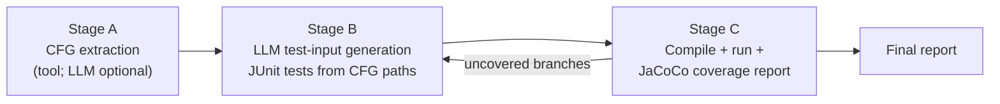

# White‑Box Testing Plan for FreeCol (`src/`)

> **Generated**: 2026‑11‑13  
> **Source stats**: [`test_docs/source_stats.csv`](source_stats.csv) (785 files, 248 214 LoC)  
> **Script**: [`test_docs/generate_stats.py`](generate_stats.py) — re‑run to refresh counts after code changes.

---

## 1. Folder Structure & Module Classification

### 1.1 Source tree overview

```
src/net/sf/freecol/
├─ FreeCol.java                    # Application entry point
├─ client/                         # UI / client‑side logic
│   ├─ FreeColClient.java          #   Client bootstrap
│   ├─ ClientOptions.java          #   Client‑side configuration
│   ├─ control/                    #   Controllers, input handling
│   ├─ gui/                        #   Swing UI components (panels, dialogs, actions, …)
│   └─ networking/                 #   Client‑side network API
├─ common/                         # Shared utilities, models, networking
│   ├─ debug/                      #   Debug helpers
│   ├─ i18n/                       #   Internationalization (messages, number rules)
│   ├─ io/                         #   I/O, serialization, save‑game files
│   │   └─ sza/                    #     Zipped‑animation support
│   ├─ logging/                    #   Logging handlers
│   ├─ metaserver/                 #   Meta‑server data structures
│   ├─ model/                      #   ★ Core game‑object model (120 classes)
│   │   ├─ mission/                #     Mission model objects
│   │   ├─ pathfinding/            #     Pathfinding algorithms
│   │   └─ production/             #     Production calculations
│   ├─ networking/                 #   Protocol message classes (115 classes)
│   ├─ option/                     #   Option / config framework
│   ├─ resources/                  #   Resource loading (images, fonts, audio)
│   ├─ sound/                      #   Sound playback
│   └─ util/                       #   General‑purpose utility methods
├─ metaserver/                     # Standalone meta‑server process
├─ server/                         # Server‑side game engine
│   ├─ FreeColServer.java          #   Top‑level server process
│   ├─ ai/                         #   AI players, missions, colony planning
│   │   ├─ colony/                 #     Colony AI planning
│   │   │   └─ plan/               #       Step‑based colony plans
│   │   ├─ military/               #     Military coordination / defensive zones
│   │   └─ mission/                #     AI mission implementations
│   ├─ control/                    #   Server‑side controllers & input handlers
│   ├─ generator/                  #   Map generation (terrain, rivers, loaders)
│   ├─ model/                      #   Server‑side model extensions & sessions
│   └─ networking/                 #   Connection handling, server socket
└─ tools/                          # Build‑time & conversion utilities
```

### 1.2 Test‑priority classification

| Priority | Meaning | Examples |
|----------|---------|----------|
| **High** | Public APIs that affect game state or core functionality; must have full unit‑test coverage. | `common/model/`, `client/control/`, `server/ai/`, `server/model/`, `server/control/`, `common/util/` |
| **Medium** | Networking and utility classes where correctness is critical but code is mostly data‑pass‑through; unit tests focus on edge cases. | `common/networking/`, `common/io/`, `common/option/`, `server/networking/`, `server/generator/`, `tools/` |
| **Low** | UI widgets that are mainly visual; integration/UI tests suffice. Unit tests only for pure‑logic helpers. | `client/gui/`, `common/resources/`, `common/sound/`, `common/debug/` |

### 1.3 Priority & workload by package

All numbers below were produced by `generate_stats.py` scanning every `.java` file under `src/`. Public method counts **exclude** constructors. Full per‑file detail is in [`source_stats.csv`](source_stats.csv).

| Package | Files | Public Methods | LoC | Priority |
|---------|------:|---------------:|----:|----------|
| `FreeCol.java` (root) | 1 | 43 | 1 727 | High |
| **`client/control/`** | 9 | 158 | 7 260 | High |
| `client/` (root) | 2 | 62 | 2 114 | Medium |
| `client/networking/` | 1 | 5 | 192 | Medium |
| `client/gui/` (all sub‑pkgs) | 331 | 2 142 | 76 235 | Low |
| **`common/model/`** (all sub‑pkgs) | 135 | 3 234 | 70 299 | High |
| **`common/util/`** | 10 | 245 | 4 842 | High |
| `common/networking/` | 115 | 624 | 19 476 | Medium |
| `common/io/` (+ sza) | 11 | 188 | 4 495 | Medium |
| `common/i18n/` | 12 | 74 | 2 414 | Medium |
| `common/option/` | 23 | 196 | 5 629 | Medium |
| `common/metaserver/` | 2 | 22 | 587 | Medium |
| `common/` (root) | 5 | 10 | 311 | Medium |
| `common/debug/` | 2 | 65 | 1 851 | Low |
| `common/logging/` | 2 | 4 | 235 | Low |
| `common/resources/` | 16 | 104 | 2 766 | Low |
| `common/sound/` | 2 | 31 | 906 | Low |
| `metaserver/` | 3 | 14 | 549 | Medium |
| `server/` (root – `FreeColServer`) | 1 | 48 | 1 404 | Medium |
| **`server/ai/`** (all sub‑pkgs) | 53 | 782 | 27 220 | High |
| **`server/control/`** | 6 | 93 | 4 509 | High |
| **`server/model/`** | 17 | 171 | 10 628 | High |
| `server/generator/` | 10 | 29 | 3 319 | Medium |
| `server/networking/` | 2 | 19 | 433 | Medium |
| `tools/` | 14 | 40 | 2 873 | Medium |
| **Grand Total** | **785** | **8 341** | **248 214** | |

> **High‑priority total**: 231 files, 4 726 public methods, 126 485 LoC  
> **Medium‑priority total**: 201 files, 1 331 public methods, 43 796 LoC  
> **Low‑priority total**: 353 files, 2 284 public methods, 77 933 LoC  

---

## 2. Scope & Ground Rules

> **Reuse note**: the existing helpers `FreeColTestCase`, `MockMapGenerator`, `MockPseudoRandom`, `ServerTestHelper` are *fixtures*, not tests. Reusing them to boot a game state is allowed and recommended; reusing existing test *cases* is not.

> **In‑scope modules**: (from [`source_stats.csv`](source_stats.csv), `priority == High`)

| Package | Files | Public Methods | LoC |
|---------|------:|---------------:|----:|
| `FreeCol.java` (root) | 1 | 43 | 1 727 |
| `client/control/` | 9 | 158 | 7 260 |
| `common/model/` | 120 | 3 101 | 67 310 |
| `common/model/mission/` | 6 | 35 | 962 |
| `common/model/pathfinding/` | 5 | 83 | 1 194 |
| `common/model/production/` | 4 | 15 | 833 |
| `common/util/` | 10 | 245 | 4 842 |
| `server/ai/` | 22 | 422 | 14 931 |
| `server/ai/colony/` | 8 | 79 | 1 803 |
| `server/ai/colony/plan/` | 2 | 3 | 292 |
| `server/ai/military/` | 3 | 29 | 938 |
| `server/ai/mission/` | 18 | 249 | 9 256 |
| `server/control/` | 6 | 93 | 4 509 |
| `server/model/` | 17 | 171 | 10 628 |
| **Total** | **231** | **4 726** | **126 485** |

---

## 3. Pipeline



### 3.1 Stage A — Build the CFG

**Goal**: C2 coverage

| Option | How | When to use |
|--------|-----|-------------|
| **A1 - Tool‑based (default)** | Compile `src/`, then extract CFGs from bytecode with a static‑analysis library (e.g. **Soot** `ExceptionalUnitGraph`, or **ASM** `Analyzer`/`Textifier`) and export DOT/JSON per method. Cross‑check `V(G)` against the JaCoCo `COMPLEXITY` counter from a baseline report. | Always. Deterministic, cheap, reproducible. |
| **A2 - LLM‑written CFG (optional)** | Give the LLM the method source and ask for a node/edge list + enumerated paths in a fixed JSON/mermaid schema. | **Lesser priority** |

**Output** (per class): `test_cft/graph/<package>/<Class>.json`, one entry per method:

```json
{
  "method": "Colony#getUnitCount()",
  "nodes": 7, "edges": 8, "cyclomatic": 3,
  "branches": [{"id": "B1", "line": 412, "cond": "units == null"}],
  "paths": [["entry","B1:true","exit"], ["entry","B1:false","loop","exit"]]
}
```

### 3.2 Stage B — LLM generates test inputs

For each class (batched, methods ordered by `V(G)` descending):

1. **Prompt context**: class source, method source, its CFG JSON (paths + branch conditions), signatures of collaborators.
2. **Ask for**: one JUnit test per CFG path (or per branch outcome when paths explode), with concrete inputs/state setup, expected result, and a comment naming the path/branch ID it targets (`// covers B1:true`).
3. **Output**: `test_cft/src/test/java/net/sf/freecol/<package>/<Class>CfgTest.java`

Budget controls: process classes in the wave order of §4; cap tokens per class; skip trivial methods (`V(G) = 1` getters/setters are covered indirectly by other tests and only generated if still uncovered after the first JaCoCo pass).

### 3.3 Stage C — Measure with JaCoCo

The current `build.xml` has `compile`, `compile-test` and a JUnit classpath (`test/lib/junit.jar`) but **no JaCoCo integration** (no `jacoco` reference found). Required additions (to be confirmed against the actual Ant output directories):

1. Put `jacocoagent.jar` and `jacococli.jar` under `test/lib/`.
2. Add an Ant target (or a script) that runs only the generated tests with the agent attached:
   ```
   java -javaagent:test/lib/jacocoagent.jar=destfile=test_docs/jacoco.exec,includes=net.sf.freecol.* \
        -cp <classes>;<generated-test-classes>;test/lib/junit.jar \
        org.junit.runner.JUnitCore <generated test classes...>
   ```
3. Produce the report **restricted to High packages** by passing only those class directories/packages to the CLI:
   ```
   java -jar test/lib/jacococli.jar report test_docs/jacoco.exec \
        --classfiles <classes>/net/sf/freecol/common/model ... \
        --sourcefiles src --html test_docs/jacoco-report --csv test_docs/jacoco.csv --xml test_docs/jacoco.xml
   ```
4. Feed `jacoco.xml` (missed branches per method) back into Stage B for a **second targeted pass** limited to uncovered lines/branches.

### 3.4 Acceptance thresholds (High packages only)

| Metric | Target |
|--------|-------:|
| Line coverage | ≥ 80 % |
| Branch coverage | ≥ 70 % |
| Method coverage | ≥ 90 % |
| Generated tests that compile and pass | ≥ 95 % |

Targets are per High package; packages that miss them are listed explicitly with the reason (e.g. needs UI/network, non‑deterministic).

---

## 4. Execution Plan (waves)

Ordered from cheapest/most deterministic to most expensive, so useful coverage is available early and the budget can stop the pipeline at any wave boundary.

| Wave | Packages | Files | Public Methods | Why this order |
|-----:|----------|------:|---------------:|----------------|
| 1 | `common/util/`, `common/model/pathfinding/`, `common/model/production/`, `common/model/mission/` | 25 | 378 | Mostly pure logic, few dependencies — validates the whole pipeline cheaply. |
| 2 | `common/model/` (core model) | 120 | 3 101 | Largest and most central; split into sub‑batches by class size (below). |
| 3 | `server/model/`, `server/control/` | 23 | 264 | Game‑state transitions; needs `ServerTestHelper`‑style fixtures. |
| 4 | `server/ai/**` | 53 | 782 | Heavy state, many collaborators; benefits from lessons of waves 2‑3. |
| 5 | `client/control/`, `FreeCol.java` | 10 | 201 | Depends on client/UI scaffolding; may need stubs, lowest expected coverage. |

### 4.1 Largest High‑priority classes (wave‑2/3/4 priorities)

Computed from `source_stats.csv`; "methods" excludes constructors.

| # | Class | Methods | LoC |
|--:|-------|--------:|----:|
| 1 | `common/model/Unit` | 254 | 4 983 |
| 2 | `common/model/Player` | 250 | 4 574 |
| 3 | `common/model/Colony` | 158 | 3 315 |
| 4 | `common/util/CollectionUtils` | 155 | 2 608 |
| 5 | `common/model/Tile` | 142 | 2 865 |
| 6 | `common/model/Specification` | 125 | 3 303 |
| 7 | `common/model/Map` | 107 | 2 870 |
| 8 | `client/control/InGameController` | 96 | 5 366 |
| 9 | `common/model/Game` | 92 | 1 874 |
| 10 | `common/model/FreeColObject` | 91 | 1 431 |
| 11 | `server/control/InGameController` | 79 | 3 957 |
| 12 | `common/model/IndianSettlement` | 77 | 1 806 |
| 13 | `server/model/ServerPlayer` | 62 | 4 666 |
| 14 | `common/model/WorkLocation` | 59 | 1 028 |
| 15 | `common/model/UnitType` | 56 | 1 058 |
| 16 | `common/model/Settlement` | 51 | 928 |
| 17 | `common/model/pathfinding/GoalDeciders` | 50 | 488 |
| 18 | `server/ai/AIUnit` | 48 | 970 |
| 19 | `FreeCol` | 43 | 1 727 |
| 20 | `server/ai/colony/TentativeColonyPlan` | 42 | 522 |
| 21 | `common/model/Europe` | 41 | 784 |
| 22 | `server/ai/Cargo` | 41 | 758 |
| 23 | `server/ai/AIMessage` | 38 | 562 |
| 24 | `server/ai/EuropeanAIPlayer` | 38 | 3 035 |
| 25 | `common/model/Building` | 37 | 584 |

The 25 classes above account for roughly 2 100 of the 4 726 in‑scope public methods.

---

## 5. Deliverables & Layout

> **Superseded paths**: the working environment, build (Maven module), exact tool versions and implementation instructions now live in [../test_cft/README.md](../test_cft/README.md) (CFG output → `test_cft/graph/`, generated tests → `test_cft/src/test/java/`, JaCoCo output → `test_cft/reports/`). Where this document's §3 shows other paths or `test/lib/jacoco*.jar`, follow `test_cft/README.md`.

```
test_docs/
├─ README.md                    # this document
├─ source_stats.csv             # scope + priority per file (generate_stats.py)
├─ generate_stats.py
├─ cfg/                         # Stage A output (JSON/DOT per class)
├─ generated_tests/src/...      # Stage B output (JUnit, *CfgTest.java)
├─ jacoco.exec / jacoco.xml / jacoco.csv
└─ jacoco-report/               # Stage C HTML report (High packages only)
```

Final report contains, per High package: files, methods, `V(G)` sum, tests generated, pass rate, line/branch/method coverage, LLM token cost, and the list of classes flagged `needs‑manual`.

---

## 6. Reproducing the Statistics

```bash
py test_docs/generate_stats.py src test_docs/source_stats.csv
```

CSV columns: `package`, `file`, `class_name`, `public_methods`, `loc`, `priority`, `rationale`. Filter `priority == High` to obtain the in‑scope file list for the pipeline.

*Public‑method counts come from a line‑based regex (single‑line `public …(` signatures, constructors excluded) and are an estimate used for planning, not an exact count.*

